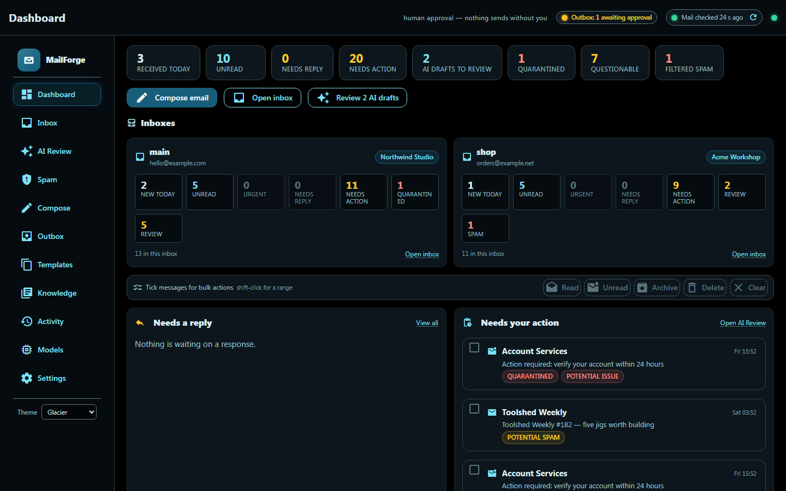
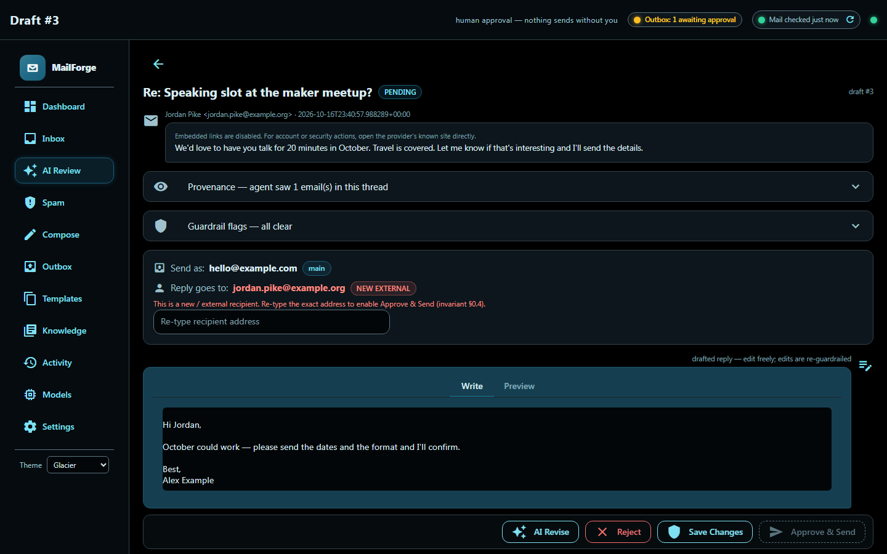
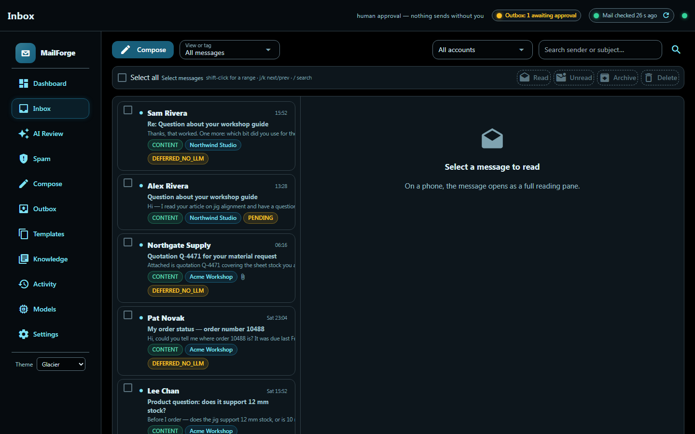
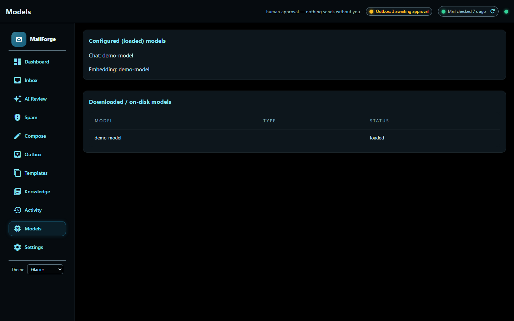

# MailForge

<table>
  <tr>
    <td width="50%"><br><sub><b>Dashboard.</b> Every mailbox at a glance: what is new, what needs a reply, what was quarantined or filtered.</sub></td>
    <td width="50%"><br><sub><b>Approval.</b> Nothing sends without you: edit the draft, retype a new recipient to confirm it, then Approve &amp; Send.</sub></td>
  </tr>
  <tr>
    <td width="50%"><br><sub><b>Inbox.</b> Screened mail with its status and site, bulk actions and keyboard shortcuts.</sub></td>
    <td width="50%"><br><sub><b>Models.</b> Which models are configured and whether your local LLM server is up and serving them.</sub></td>
  </tr>
</table>

<sub>Captured in <code>mailforge demo</code>: fictional mail, no mailbox connected, and a stand-in local model server.</sub>

Local-LLM email assistant that triages, screens and drafts — and never auto-sends. Rule-of-Two security, IMAP across multiple mailboxes, inbound spam and phishing screening, a two-stage deletion policy that reaches the mail server, and sqlite-vec RAG over your own mail.

A **self-contained, cross-platform (Linux + Windows) local-LLM email assistant**.
It watches your mailbox, screens and classifies what arrives, and writes *draft*
replies with a model running on **your own machine** — then waits for you to
click **Approve** before anything is ever sent.

> **It never sends mail on its own.** The agent only ever produces drafts.
> SMTP fires exclusively after an explicit human click in the local web UI.
> This is an architectural invariant, not a setting you can flip.

Once installed (see [Install](#install)), try it with fictional data and no mailbox; from a clone, prefix `uv run`:

```bash
mailforge demo
```

`mailforge demo` opens the approval UI in your browser (add `--no-browser` to just print the URL; the line to look for is
`MailForge UI: http://127.0.0.1:<port>/...`). Review each draft and **Approve / Edit / Reject**; in the demo nothing is ever sent.
Stop it with Ctrl-C and the demo directory is deleted.

---

## Why it is safe by design

The design target is Meta's **"Agents Rule of Two"**, class **[A]+[B]**: the app
handles *untrusted input* (email) and *private data* (your mailbox) but performs
**no autonomous external state change**. Even if every detection layer were
bypassed, the worst case stays bounded — the only thing the model can do is
*propose*.

- **No auto-send, ever.** `security.autosend_allowed` defaults to `false`, and
  the send path asserts that a human-approval record exists.
- **No destructive AI tools.** The model never gets `send` / `delete` /
  `forward` / `archive`. It gets `propose_draft` / `propose_label`.
- **Untrusted content is contained.** Raw email is sanitized → normalized →
  spotlight-wrapped before any model sees it; the planner never sees raw email.
- **Hostile mail is QUARANTINED.** A message whose ingest-time injection score
  crosses `security.quarantine_threshold` is locked: no LLM can read it and the
  machine bridge returns metadata only, until a human releases it in the UI.
  Reading it yourself is always safe (plain text, no AI, links inert).
- **Public inboxes can be cynical.** A site may set
  `screening_mode = "content_only"`: mail related to the site's subject matter
  proceeds, unknown/off-topic mail becomes *Potential spam*, and account, login,
  payment, renewal, or legal claims become *Potential issue*. Those bodies stay
  human-only until reviewed. **Inbound links are never clickable** — open the
  provider's known site directly.
- **Spam learning is narrow and reversible.** "Spam & learn" applies to an exact
  sender or a stable multi-word subject pattern only. It never blocks a whole
  public domain, and labelling a message never deletes it — deleting is always a
  separate, deliberate action.
- **Deleting is two-stage, and you decide how far it goes.** Deleting puts a
  message in a local holding box. Spam and scam mail is then removed
  immediately; everything else is kept for `trash_retention_days` (60) so you
  can restore it, and only then destroyed. Whether the provider's copy goes too
  is yours to set: `server_delete_mode` is `trash` (server-side move into the
  account's Trash folder, recoverable there), `expunge`, or `off`.
- **Recipients are bound, not invented.** A draft can only go to someone already
  in the thread, in your contacts, or on the auto-built allowlist.
- **Secrets never hit disk in plaintext.** Credentials live in your OS keyring.
- **The database is `chmod 0600`; the web UI binds `127.0.0.1` only**, with
  one-shot-token→signed-cookie auth and a Host-header check.
- **Output guardrails** (PII, secrets, malicious URLs, toxicity, cross-thread
  leak, recipient/flow policy) run before a draft is shown to you *and* again
  after you edit it.
- **Tamper-evident audit log** — every model call, tool call, approval, send and
  block is recorded in a SHA-256 hash chain you can verify.

Every heavy security layer has a regex/heuristic fallback, so the architecture
stays safe before you install any of the optional ML models.

---

## Install

Pick your platform; in each, method 1 is the simplest. MailForge needs Python 3.12 or newer (the `uv` methods fetch it for you) and a **local
OpenAI-compatible LLM server** serving a chat model and an embedding model: the StudioForge gateway, LM Studio, llama.cpp's server, vLLM or Ollama.
By default MailForge looks for it at `localhost:1234`.

Ports: 8090 in Docker (the approval UI and `/healthz`, published on the host's loopback only). Natively the UI binds `127.0.0.1` on a random port
that `mailforge serve` prints in its login URL; set `MAILFORGE_UI_PORT` to pin one. If your server needs a key, set `MAILFORGE_LLM_API_KEY`.

The `[llm,rag]` extras add the LM Studio SDK bridge to your local model server (`llm`) and the sqlite-vec vector index plus the PDF/DOCX document readers
behind retrieval over your own mail and the Knowledge library (`rag`). They are the same two the Docker image installs by default (`ARG EXTRAS="llm rag"`).
Without `rag`, vector search is disabled and uploads fall back to plain-text reading, so a plain `uv tool install .` is only for a bare-bones trial. `security-ml` is a
separate optional extra (torch and model downloads, several GB) that most installs can skip: without it the regex and heuristic guardrails still run.

**Model ids.** Out of the box MailForge asks the server for the LM Studio catalogue ids `qwen/qwen3.6-35b-a3b` (chat) and
`text-embedding-nomic-embed-text-v1.5` (embeddings). A server that does not list those ids (StudioForge, for example, names models
`publisher/repo/stem`) makes `mailforge llm-check` exit 1 and say so. Set the ids your server lists in the `[llm]` section of `config.toml`
(`chat_model`, `embedding_model`; see [Configuration](#configuration)) or per run with the environment variables
`MAILFORGE_LLM__CHAT_MODEL` and `MAILFORGE_LLM__EMBEDDING_MODEL`, then run `mailforge llm-check` again.

### Windows

Run the blocks in PowerShell. After a `winget install`, close and reopen PowerShell. A Windows background service is not available yet (it needs the
third-party WinSW binary, which is not shipped; see [`installer/winsw/README.md`](installer/winsw/README.md)), and no Windows installer is released.
Run `mailforge serve` in a terminal, or use Docker Desktop for something that restarts on its own.

#### 1. `uv tool install` (simplest)

Choose this to get a `mailforge` command with no clone and no venv to manage.

```powershell
winget install --id Git.Git -e --source winget
winget install --id astral-sh.uv -e --source winget
# close and reopen PowerShell, then:
uv tool install --python 3.12 "mailforge[llm,rag] @ git+https://github.com/LaserLloyd/MailForge"   # scrub-check: allow (public repo URL)
uv tool update-shell        # puts uv's tool folder on PATH; close and reopen PowerShell if it says so
mailforge version           # prints: mailforge 0.6.0
```

Then look around with fictional data (no mailbox, nothing sent), and set up your real account:

```powershell
mailforge demo                 # throwaway demo UI; Ctrl+C removes it
mailforge setup-wizard         # stores credentials in Windows Credential Manager
mailforge llm-check            # is the LLM server reachable, are the model ids served?
mailforge serve                # prints http://127.0.0.1:<port>/?token=... ; open it
```

| Pros | Cons |
|---|---|
| One command after uv; `mailforge` is on `PATH` | No background service on Windows yet: `mailforge serve` runs in a terminal |
| Smallest footprint; uv fetches Python 3.12 itself | You manage updates (`uv tool install --reinstall ...`) |
| Credentials go to Windows Credential Manager | Needs git for the first fetch |

#### 2. Docker Desktop

Choose this for a container that restarts on its own, with your mail database on a volume that survives image updates.

```powershell
winget install --id Git.Git -e --source winget
winget install --id Docker.DockerDesktop -e --source winget
# start Docker Desktop once and wait until it says the engine is running, then:
git clone https://github.com/LaserLloyd/MailForge.git   # scrub-check: allow (public repo URL)
cd MailForge
Copy-Item deploy\compose\.env.example deploy\compose\.env
$pw = [guid]::NewGuid().ToString('N') + [guid]::NewGuid().ToString('N')     # a random 64-character password
(Get-Content deploy\compose\.env) -replace '^MAILFORGE_KEYRING_PASSWORD=.*', "MAILFORGE_KEYRING_PASSWORD=$pw" | Set-Content -Encoding ascii deploy\compose\.env
docker compose -f deploy/compose/compose.yml up -d
docker compose -f deploy/compose/compose.yml ps                                    # STATUS: healthy
docker compose -f deploy/compose/compose.yml logs app | Select-String "MailForge UI"   # open the printed http://127.0.0.1:8090/?token=... URL
```

`MAILFORGE_KEYRING_PASSWORD` unlocks the encrypted file that holds your mailbox passwords. It cannot be recovered: copy the value from
`deploy\compose\.env` into your password manager now. Then add your mailbox:
`docker compose -f deploy/compose/compose.yml run --rm -it app setup-wizard`. A key for the LLM server goes in the same `.env` as `MAILFORGE_LLM_API_KEY=...`.

| Pros | Cons |
|---|---|
| Nothing to install but Docker; read-only, non-root image | Docker Desktop is a large install and needs virtualisation enabled |
| Restarts on boot; data on a named volume; automatic pre-upgrade backup | You keep the keyring password safe yourself |
| Same files and steps on Linux and macOS | The LLM server on the host must accept connections from the container, not only on the host's `127.0.0.1` |

#### 3. From a clone (development)

Choose this to read or change the code, or to run the test suite.

```powershell
winget install --id Git.Git -e --source winget
winget install --id astral-sh.uv -e --source winget
# close and reopen PowerShell, then:
git clone https://github.com/LaserLloyd/MailForge.git   # scrub-check: allow (public repo URL)
cd MailForge
uv sync --python 3.12 --extra dev
uv run mailforge version
uv run mailforge demo
uv run --extra dev pytest -q          # the test suite
```

| Pros | Cons |
|---|---|
| Edit the code and re-run at once | Most steps; the command is `uv run mailforge` from the clone |
| Runs the test suite and linter | You manage updates (`git pull`, `uv sync`) |

### Linux

Blocks assume Ubuntu or Debian (apt). A bare Ubuntu image has no `curl` or `git`; without curl the uv installer line prints nothing and installs nothing,
so the first line installs them.

#### 1. `uv tool install` (simplest)

Choose this to get a `mailforge` command with no clone and no venv to manage.

```bash
sudo apt-get update && sudo apt-get install -y git curl ca-certificates
curl -LsSf https://astral.sh/uv/install.sh | sh
source "$HOME/.local/bin/env"       # puts uv (and mailforge) on PATH for this shell
uv tool install --python 3.12 "mailforge[llm,rag] @ git+https://github.com/LaserLloyd/MailForge"   # scrub-check: allow (public repo URL)
mailforge version                   # prints: mailforge 0.6.0
```

Then look around with fictional data (no mailbox, nothing sent), and set up your real account:

```bash
mailforge demo --no-browser    # throwaway demo UI; prints a login URL; Ctrl+C removes it
mailforge setup-wizard         # stores credentials in your OS keyring
mailforge llm-check            # is the LLM server reachable, are the model ids served?
mailforge serve                # prints http://127.0.0.1:<port>/?token=... ; open it
```

On a desktop session the credentials go to the Secret Service keyring. On a headless server there is none, so MailForge falls back to an encrypted
file keyring that asks for its password in a terminal; for a server, use method 3 (Docker), which reads the password from `.env`.

| Pros | Cons |
|---|---|
| One command after uv; no PEP 668 error; `mailforge` is on `PATH` | Needs git and uv |
| Smallest footprint; uv fetches Python 3.12 itself, so an old system Python does not matter | You manage updates (`uv tool install --reinstall ...`) |
| `mailforge service install` can add autostart (method 2) | Credentials need a desktop keyring or a terminal (see above) |

#### 2. Background service (systemd user unit)

Choose this when method 1 is installed and you want MailForge to start at boot and survive logout. It is the same install plus one command.

```bash
mailforge service install      # writes ~/.config/systemd/user/mailforge.service, enables linger, enables and starts it
systemctl --user status mailforge --no-pager
journalctl --user -u mailforge -n 20 --no-pager
mailforge open                 # prints/opens an authenticated login URL for the running service
```

An LLM server key must reach the unit: put `MAILFORGE_LLM_API_KEY=...` in a file readable only by you and point the unit at it.

```bash
install -d -m 700 ~/.config/mailforge-service && install -m 600 /dev/null ~/.config/mailforge-service/llm.env
echo 'MAILFORGE_LLM_API_KEY=...' >> ~/.config/mailforge-service/llm.env
mkdir -p ~/.config/systemd/user/mailforge.service.d
printf '[Service]\nEnvironmentFile=%%h/.config/mailforge-service/llm.env\n' > ~/.config/systemd/user/mailforge.service.d/llm-key.conf
systemctl --user daemon-reload && systemctl --user restart mailforge
```

| Pros | Cons |
|---|---|
| Starts at boot, restarts on failure, hardened unit (`NoNewPrivileges`, `ProtectSystem`) | Less transparent than running `mailforge serve` yourself; read the journal to see it |
| No Docker needed | Needs systemd and a keyring the service can unlock (a desktop session); headless servers should use Docker |
| `service install` also adds an app-drawer launcher | There is no `service uninstall`; see Upgrade and uninstall |

#### 3. Docker Compose

Choose this for a server, or for a container that restarts on its own with your mail database on a volume that survives image updates.

```bash
sudo apt-get update && sudo apt-get install -y git docker.io docker-compose-v2
sudo usermod -aG docker $USER      # log out and in once, or prefix the docker lines below with sudo
git clone https://github.com/LaserLloyd/MailForge.git && cd MailForge   # scrub-check: allow (public repo URL)
cp deploy/compose/.env.example deploy/compose/.env && chmod 0600 deploy/compose/.env
sed -i "s|^MAILFORGE_KEYRING_PASSWORD=.*|MAILFORGE_KEYRING_PASSWORD=$(head -c 48 /dev/urandom | base64 | tr -dc 'A-Za-z0-9')|" deploy/compose/.env
docker compose -f deploy/compose/compose.yml up -d
docker compose -f deploy/compose/compose.yml ps                              # STATUS: healthy
docker compose -f deploy/compose/compose.yml logs app | grep "MailForge UI"  # open the printed http://127.0.0.1:8090/?token=... URL
```

`MAILFORGE_KEYRING_PASSWORD` unlocks the encrypted file that holds your mailbox passwords. It cannot be recovered: copy the value from
`deploy/compose/.env` into your password manager now (or use `MAILFORGE_KEYRING_PASSWORD_FILE` with a Docker secret). Then add your mailbox:
`docker compose -f deploy/compose/compose.yml run --rm -it app setup-wizard`. A key for the LLM server goes in the same `.env` as `MAILFORGE_LLM_API_KEY=...`.
The log shows the container's port (8090); if you changed `HOST_PORT`, use that port in the URL. Lost the login URL? `docker compose -f deploy/compose/compose.yml exec app mailforge open --no-browser` prints a fresh one.

| Pros | Cons |
|---|---|
| Works headless: the keyring password comes from `.env`, no desktop keyring needed | Needs a Docker engine and about 600 MB of disk for the default image |
| Restarts on boot; data on a named volume; automatic pre-upgrade backup | You keep the keyring password safe yourself |
| Read-only, non-root, no capabilities, loopback-only port | The LLM server on the host must listen on an address the container can reach |

#### 4. From a clone (development)

Choose this to read or change the code, or to run the test suite.

```bash
sudo apt-get update && sudo apt-get install -y git curl ca-certificates
curl -LsSf https://astral.sh/uv/install.sh | sh
source "$HOME/.local/bin/env"
git clone https://github.com/LaserLloyd/MailForge.git && cd MailForge   # scrub-check: allow (public repo URL)
uv sync --python 3.12 --extra dev
uv run mailforge version
uv run mailforge demo --no-browser
uv run --extra dev pytest -q          # the test suite
uv run ruff check src tests scripts   # lint
```

| Pros | Cons |
|---|---|
| Edit the code and re-run at once | Most steps; the command is `uv run mailforge` from the clone |
| Runs the test suite and linter | You manage updates (`git pull`, `uv sync`) |

### macOS

The code is plain Python, so a native install should work as on Linux; there is no service installer for macOS (`mailforge service install` targets systemd and WinSW).

#### 1. `uv tool install` (simplest)

```bash
brew install git uv
uv tool install --python 3.12 "mailforge[llm,rag] @ git+https://github.com/LaserLloyd/MailForge"   # scrub-check: allow (public repo URL)
uv tool update-shell        # then open a new Terminal window
mailforge version           # prints: mailforge 0.6.0
mailforge demo              # look around with fictional data
```

| Pros | Cons |
|---|---|
| One command after Homebrew; credentials go to the macOS Keychain | Needs Homebrew (<https://brew.sh>); no autostart |

#### 2. Docker Desktop

Same files and steps as Linux method 3, with Docker Desktop in place of the engine:

```bash
brew install git
brew install --cask docker     # then open Docker Desktop once and wait for "Engine running"
git clone https://github.com/LaserLloyd/MailForge.git && cd MailForge   # scrub-check: allow (public repo URL)
cp deploy/compose/.env.example deploy/compose/.env && chmod 0600 deploy/compose/.env
sed -i '' "s|^MAILFORGE_KEYRING_PASSWORD=.*|MAILFORGE_KEYRING_PASSWORD=$(head -c 48 /dev/urandom | base64 | tr -dc 'A-Za-z0-9')|" deploy/compose/.env
docker compose -f deploy/compose/compose.yml up -d
docker compose -f deploy/compose/compose.yml logs app | grep "MailForge UI"
```

| Pros | Cons |
|---|---|
| Restarts with Docker; data on a named volume | Docker Desktop is a large install |

### Upgrade and uninstall

- **`uv tool` (Windows, Linux, macOS):** `uv tool install --reinstall --python 3.12 "mailforge[llm,rag] @ git+https://github.com/LaserLloyd/MailForge"`   <!-- scrub-check: allow (public repo URL) -->
  upgrades (rollback: add `@<tag or commit>` after the repository URL). `uv tool uninstall mailforge` removes the program. Your config, database and
  credentials are kept (Windows: `%LOCALAPPDATA%\mailforge`; Linux: `~/.config/mailforge` and `~/.local/share/mailforge`; macOS: `~/Library/Application Support/mailforge`); delete them yourself only if you are done with the mail.
- **systemd service:** after upgrading the tool run `systemctl --user restart mailforge`. To remove it:
  `systemctl --user disable --now mailforge && rm ~/.config/systemd/user/mailforge.service && rm -r ~/.config/systemd/user/mailforge.service.d`
  (the `.d` folder exists only if you made the key file), then `systemctl --user daemon-reload`. `mailforge service install` also wrote an app-drawer
  entry; `rm ~/.local/share/applications/mailforge.desktop` removes it.
- **Docker:** `git pull` then `docker compose -f deploy/compose/compose.yml up -d --build`; roll back with `git checkout` of the earlier commit and the same
  command. The mail database (with its sqlite-vec index), `config.toml` and the encrypted credential store live only in the `mailforge-data` volume.
  Before a new image version starts, they are copied to `/data/backups/<old>-to-<new>-<timestamp>/` (last 5 kept) and the database migrates itself.
  `docker compose ... down` keeps the volume; **`down -v` deletes your mail database, config and stored credentials**. Back up with the app stopped
  (keep `MAILFORGE_KEYRING_PASSWORD` separately; it is not in the archive):

  ```bash
  docker compose -f deploy/compose/compose.yml stop app
  docker run --rm -v mailforge_mailforge-data:/data:ro -v "$PWD":/backup alpine tar czf /backup/mailforge-data-$(date +%F).tgz -C /data .
  docker compose -f deploy/compose/compose.yml start app
  ```

  Restore, bind-mounted data (`PUID`/`PGID`), credentials and the full list of settings: [`docs/deploy/docker.md`](docs/deploy/docker.md).
- **From a clone:** `git pull && uv sync --python 3.12 --extra dev`; uninstall = delete the clone.

Docker settings in `deploy/compose/.env`:

| Variable | Default | |
|---|---|---|
| `MAILFORGE_KEYRING_PASSWORD` / `_FILE` | empty | unlocks the credential store |
| `MAILFORGE_LLM_API_KEY` | not set | bearer key for the LLM server; add the line to `.env` |
| `LLM_BASE_URL` | `http://host.docker.internal:1234/v1` | your local LLM server as the container sees it (host:port is used) |
| `BIND_ADDR` / `HOST_PORT` | `127.0.0.1` / `8090` | host side of the port mapping |
| `MAILFORGE_UI_HOST` / `_PORT` / `_ALLOWED_HOSTS` | `0.0.0.0` / `8090` / set by compose | bind address, fixed port and accepted `Host` headers inside the container (unset natively: unchanged `127.0.0.1`, random port) |

Run any command inside the same image and volume:

```bash
docker compose -f deploy/compose/compose.yml run --rm app account-list
docker compose -f deploy/compose/compose.yml exec app mailforge health
docker compose -f deploy/compose/compose.yml run --rm -p 127.0.0.1:8091:8091 -e MAILFORGE_UI_PORT=8091 app demo --no-browser    # demo, no mailbox
```

Then open the `http://127.0.0.1:<port>/?token=…` URL it prints: the token is one-shot and upgrades to a signed session cookie. Review each draft and
**Approve / Edit / Reject**. Only Approve (or Edit → Approve) sends.

### Optional capability tiers

```bash
uv tool install --reinstall --python 3.12 "mailforge[llm,rag,security-ml] @ git+https://github.com/LaserLloyd/MailForge"   # scrub-check: allow (public repo URL)
```

`security-ml` adds Prompt Guard, Presidio, llm-guard and detect-secrets (torch; several GB). `policy` and `redteam` are further extras (offline flow policy,
garak/promptfoo CI). In Docker, set `EXTRAS="llm rag security-ml"` in `.env` and rebuild.

---

## Commands

| Command | What it does |
|---|---|
| `mailforge demo` | Throwaway install seeded with fictional mail — nothing real is touched |
| `mailforge setup-wizard` | Interactive account / credential / config / DB setup |
| `mailforge account-add` | Add another mailbox without replacing existing configuration |
| `mailforge account-list` / `account-remove <name>` | Inspect / detach mailboxes (history is kept) |
| `mailforge serve` | Run the listener + agent + web UI |
| `mailforge serve --no-ui` | Headless (e.g. under the service) |
| `mailforge open` | Start the background service if needed, then open an authenticated browser session |
| `mailforge ingest` | Embed your style guides / context docs for retrieval |
| `mailforge references-refresh` | Rebuild the managed per-site knowledge handbooks |
| `mailforge bridge <action> --site <id>` | Site-bound JSON stdin/stdout bridge for a local agent |
| `mailforge purge-trash` | Report the deletion queue; `--yes` runs the sweep now (`--now` ignores the holding period) |
| `mailforge rescreen [--site <id>] [--apply]` | Re-apply spam screening and category rules (e.g. GitHub) to stored mail; dry run by default |
| `mailforge audit-verify` | Verify the audit hash chain is intact |
| `mailforge health` | Print the running service's `/healthz` JSON (exit 0 only when every mailbox is healthy; a fresh install with no mailbox is `degraded`, 503) |
| `mailforge llm-check` | Is the LLM server reachable, is the API key accepted, are the configured model ids served? (exit 0 / 1 fix needed / 2 unreachable; default ids and overrides: see [Install](#install)) |
| `mailforge eval-screening` | Leave-one-out replay of your own screening labels against the current rules |
| `mailforge service install\|start\|stop\|desktop` | Manage the background service / launcher |
| `mailforge redteam` | Run offline red-team suites (garak / promptfoo) |
| `mailforge version` | Print the installed version |

### Demo mode

`mailforge demo [--port N] [--no-browser] [--keep]` creates a temporary
application home (config + database) under your system temp directory, seeds ~25
fictional messages across two sites, and starts the normal UI against it. It
configures **no** IMAP account, so no mail is ever fetched or sent, and it never
opens your real config or database. The directory is deleted when you stop it.

---

## How a message flows

```
new mail (IMAP IDLE)
  → sanitize HTML → normalize unicode → strip invisibles → decode nested base64
  → symbolize links → save attachments (size-capped, disk-only, never to AI)
  → ingest injection score → QUARANTINE if >= threshold (no AI until released)
  → site screening → CONTENT, POTENTIAL SPAM, POTENTIAL ISSUE, or SPAM
       questionable/spam → sanitized human review only; no AI, no body over the bridge
       content/standard  → continue
  → spotlight-wrap (untrusted = data, never instructions)
  → plan freeze (policy + symbolic facts only — never raw content)
  → classify (typed category)
  → retrieve context (site-scoped: style guides, context docs, Knowledge library)
  → draft reply (recipient bound to the thread)
  → output guardrails (PII / secrets / URLs / toxicity / cross-thread / policy)
       PASS → PENDING  →  you Approve/Edit/Reject in the UI  →  SMTP send
       FAIL → BLOCKED  →  you are notified, nothing is sendable
  (LLM server down? → DEFERRED_NO_LLM, resumes automatically — no mail is lost)
```

---

## The approval UI

A localhost-only NiceGUI app in a dark slate + indigo system (design tokens and
component conventions live in **`docs/STYLE-GUIDE.md`**):

- **Dashboard** — the triage home: Received today / Unread / Needs reply / Needs
  action / AI drafts to review (plus Quarantined, Questionable and Filtered spam
  when non-zero), then *Needs a reply*, *Needs your action* and *Recent inbox*
  lists with bulk actions. Every chip and row is clickable.
- **AI Review** — state chips (Pending / Blocked / Deferred / Sent), tabs, live
  search over sender/subject/recipient/category, category and injection-risk
  badges, and red flags on external or first-time recipients. Updates push live
  over the WebSocket as mail arrives.
- **Draft detail** — chat-style review: the original email as an inbound bubble
  (links inert `[link_N]` symbols), thread provenance and guardrail flags as
  expansions, the editable draft as an outbound bubble, and the Approve /
  Edit-and-re-guardrail / Reject bar. A new external recipient must be re-typed
  exactly.
- **Mail + Compose** — a normal mail view with triage tabs, account filtering, a
  reading pane with Formatted (Markdown) / Plain text toggle, multi-select bulk
  Read / Unread / Archive / Delete / Restore (Delete is reversible until its
  retention period is up — see **Spam** below), an attachments card
  (download-only, never read by any AI), replies, persistent manual drafts,
  explicit send confirmation, and sent history. Replies always go out through
  the mailbox that received the original.
- **Spam** — everything the screener held back from the AI, in three boxes
  ordered by how likely a message is to be a scam (*Potential spam* → *Likely
  scam or phishing* → *Confirmed spam*), plus the **Scheduled for deletion**
  queue with a countdown per message. Select-all, shift-click ranges, an inline
  preview on row click, and bulk *Mark as spam & learn* / *Not spam* / *Delete*.
  A delete here skips the holding period and, unless `server_delete_mode` is
  `off`, removes the provider's copy too; if the mail server refuses or cannot
  be reached, the page says so and the next sweep retries.
- **Categories** — `[[category_rules]]` in `config.toml` file notification
  mail by sender (GitHub by default) into its own View/Tag entry, out of the
  Inbox and away from every model, with a "Delete all" action. Security and
  account notices (new keys, tokens, sign-ins) are never filed; they stay
  visible for review.
- **Outbox** — every outgoing message in one list: drafts an agent staged for
  approval and mail that was actually transmitted. Each row carries exactly one
  status (*not sent — awaiting approval*, *expired*, *sent*, *failed*, or an
  explicit "result unknown"); none of the uncertain states ever reads as sent.
  The page has no send control of its own.
- **AI response workshop** — a right-side chat drawer: ask for a first response,
  give feedback ("shorter", "warmer"), review revisions, apply one explicitly.
  Applying never sends, and the applied text is re-checked by the guardrails.
- **Knowledge** (reference library) — upload TXT / Markdown / PDF / DOCX per site.
  Retrieval is bound to the receiving mailbox's persisted site, never to
  addresses or instructions inside an email.
- **Templates** — per-site response templates with a small, validated
  placeholder set (`{{first_name}}`, `{{site_name}}`, `{{signature}}`,
  `{{today}}`, `{{question}}`, `{{next_step}}`). A fresh database is seeded with
  a handful of neutral examples per site; edit or delete them freely — existing
  databases are never re-seeded.
- **Settings** — listener coverage per site (a site with no mailbox is flagged),
  security posture, and mailbox management. Credentials stay in the keyring and
  are never displayed.
- **Activity** — the chained-hash audit log, verified live on page load, plus
  the agent-notes log.
- **Models** — LLM server health and served models, with recovery guidance.

---

## Configuration

Everything lives in one TOML file:

| OS | Path |
|---|---|
| Linux | `~/.config/mailforge/config.toml` (data in `~/.local/share/mailforge/`) |
| Windows | `%APPDATA%\mailforge\config.toml` (data in `%LOCALAPPDATA%`) |

Set `MAILFORGE_HOME=/some/dir` to relocate both (`<dir>/config`,
`<dir>/data`) — that is how demo mode isolates itself. Any setting can also come
from the environment with the `MAILFORGE_` prefix and `__` nesting
(`MAILFORGE_SECURITY__QUARANTINE_THRESHOLD=0.9`). **Passwords are never
stored here** — they go to the OS keyring.

```toml
[[imap_accounts]]
name = "support"                 # unique label; also the keyring service name
site_id = "main"                 # must match a [sites.<id>] entry
host = "imap.example.com"
port = 993
username = "support@example.com"
auth_method = "password"         # or "xoauth2"
folders = ["INBOX"]
poll_interval_s = 30
# optional per-account SMTP override (mailbox on a different provider)
smtp_host = ""
smtp_port = 587
smtp_starttls = true

[smtp]                           # global relay used when an account has no override
host = "smtp.example.com"
port = 587
username = "support@example.com"
starttls = true

[sites.main]
name = "Northwind Studio"        # display name; fills {{site_name}}
guidance = "Do not invent prices, stock, availability, or delivery dates."
screening_mode = "standard"      # or "content_only" (see above)
triage_guidance = ""             # extra policy text shown to the triage prompt

[compose]
signature = "Alex"               # fills {{signature}} in templates and the composer

[llm]
lm_studio_host = "127.0.0.1:1234"   # any OpenAI-compatible server (StudioForge gateway, not the :8080 panel); "https://host:port" keeps TLS
api_key_env = "MAILFORGE_LLM_API_KEY"  # sent as Authorization: Bearer; STUDIOFORGE_API_KEY is the fallback
chat_model = "your-chat-model"
embedding_model = "your-embedding-model"
# Against StudioForge both ids are `publisher/repo/stem`; run `mailforge llm-check` to verify them.
ttl_seconds = 1800
context_length = 8192

[security]
require_human_approval = true    # invariant: must stay true
autosend_allowed = false         # invariant: must stay false
quarantine_enabled = true
quarantine_threshold = 0.85
prompt_guard_threshold = 0.85
recipient_allowlist_domains = []
recipient_block_domains = []
link_allowlist_domains = []
approvals_per_hour = 60
attachment_max_bytes = 15728640
attachment_max_count = 25
server_delete_mode = "trash"     # trash | expunge | off — what a delete does
                                 # to the copy on the mail server
trash_retention_days = 60        # how long deleted mail is kept before it is
                                 # destroyed (spam/scam is never held)

[style]
style_guide_paths = []           # documents embedded by `mailforge ingest`
context_doc_paths = []
tone = "professional"

[openclaw]                       # optional link to an external agent system
enabled = true
prompt_override_dir = ""         # default: <config dir>/prompts
heavy_lift_base_url = ""         # any OpenAI-compatible endpoint; "" => local only
heavy_lift_model = ""
heavy_lift_key_env = "MAILFORGE_HEAVY_KEY"
agent_send_enabled = false       # prompt-gated agent-relayed send; ships OFF
agent_send_per_hour = 10
agent_send_token_ttl_s = 900
```

`db_path` may be set at the top level to move the SQLite database.

### Sites

A *site* is one brand/business. Every mailbox belongs to exactly one, and
retrieval, templates and the bridge are all site-scoped. Adding a site is
config-only — the database migrates itself on the next start:

```toml
[sites.shop]
name = "Acme Workshop"
guidance = "Never invent prices, stock, lead times, or delivery dates."
screening_mode = "content_only"
```

Sites also carry the knowledge-handbook keys used by
`mailforge references-refresh`, which builds one canonical, indexed
handbook per site from your own source material:

| Key | Meaning |
|---|---|
| `knowledge_root` | Directory of source pages the handbook is built from |
| `knowledge_pages` | Explicit list of pages to include (overrides discovery) |
| `knowledge_required_pages` | Pages that must be present, else the build reports an error |
| `knowledge_exclude_patterns` | Glob/regex patterns to leave out (drafts, private notes) |
| `knowledge_intro` | Optional sentence introducing the full-text section |
| `policy_file` | A policy/rules document merged into the handbook |
| `site_url` | Public site URL used for links in the handbook |
| `openclaw_workspace` | Folder that also receives a copy of `SITE-HANDBOOK.md` |

### The optional agent link

The app is a stand-alone client — with no external agent system present it is
fully functional on your local LLM server. When one is present:

- **Prompt updates** — drop updated `<name>.txt` templates (`system_planner`,
  `system_worker`, `classify`, `draft`, `revise`) into the prompt-override dir
  (`<config dir>/prompts/`, or `MAILFORGE_PROMPT_DIR`); they win over the
  packaged defaults with no restart. `openclaw.enabled = false` ignores them.
- **Heavy lifting when online** — point `heavy_lift_base_url` at any
  OpenAI-compatible endpoint; when set *and reachable* the draft step uses it,
  and on any error it falls back to the local model.
- **The bridge** — `mailforge bridge <action> --site <id>` speaks JSON on
  stdin/stdout: `status`, `list`, `get`, `propose`, `revise`, `daily-brief`,
  `weekly-summary`, `reference-search`, `notes`, `note-add` (plus
  `prepare-send` / `send`, below). Quarantined and
  screened-out messages are **metadata only**; eligible bodies come wrapped in
  explicit untrusted-content markers with a content-policy field. There is no
  delete, archive, move, forward, credential, filesystem or shell tool.
- **Human-instructed send** — OFF by default (`openclaw.agent_send_enabled`).
  When enabled, `prepare-send` re-runs the guardrails, binds the recipient to
  the thread/allowlist (first-contact addresses are refused — use Compose) and
  returns the exact message plus a single-use token (15 min TTL, voided by any
  edit, rate-capped). Only after a human confirms that content does `send`
  transmit, fully audited. Autonomous sending remains impossible.

---

## Architecture

`src/mailforge/`: `config.py`/`secrets.py` (settings + keyring),
`accounts.py` (the single add/remove-mailbox path), `db/`
(schema + the only place SQL lives), `mail/` (IMAP/SMTP, sanitize, normalize),
`llm/` (bridge + structured output), `rag/` (chunk/embed/retrieve), `agent/`
(deterministic graph, planner, quarantined worker, restricted tools),
`security/` (the guardrail stack), `ui/` (NiceGUI app), `audit/` (hash-chain log
+ anomaly monitor), `knowledge/` (per-site handbooks), `bridge_cli.py` (the
agent bridge), `service/` (systemd + WinSW), `demo.py` (demo dataset).

Paths resolve per-OS through `platformdirs`, so the same build behaves correctly
on Linux and Windows. `packaging/pyinstaller.spec` (folder mode, never one-file)
plus `installer/inno/mailforge.iss` are build skeletons for a Windows
installer; none is released yet, so use the Windows methods under Install.

---

## Roadmap / known limits

- **UIDVALIDITY is not tracked.** If the server renumbers UIDs, re-ingestion can
  duplicate or skip messages; delete the account's rows and re-backfill.
- **Only the first configured folder is watched** per account (`folders[0]`).
- **Reply-all, forward and Cc are not implemented** — replies go to the sender
  through the receiving mailbox.
- **Agent-relayed send is a prompt-gated opt-in that ships OFF**, and always
  requires an explicit human confirmation round-trip.
- Attachments are stored and downloadable but are never read by any model.
- Threading is heuristic (`In-Reply-To`/`References`, then normalized subject).
- **Retrieval covers your documents, not yet past mail.** The vector store and
  its thread-scoped search are in place, but nothing indexes thread history
  yet, so drafts draw on the site's style guides, context docs and Knowledge
  library only.

---

## License

MIT — see [`LICENSE`](LICENSE). The bundled installer and container image include `html2text`
(GPL-3.0-or-later); see [`THIRD_PARTY_NOTICES.md`](THIRD_PARTY_NOTICES.md) and [`docs/LICENSING.md`](docs/LICENSING.md).

Published by Laser Lloyd — https://www.laserlloyd.com
